  

  
  
  

I'm a full-stack developer and SaaS founder from Uberaba, Brazil. I build tools for AI coding agents and automation for real businesses, from the database to the desktop app.

## Now building: Floq

  

**A desktop workspace for running Claude Code and Codex agents on a server you host.** You start agents in cloud terminals, arrange them on a canvas with notes and wires, and they keep working after you close the laptop. Lead agents recruit subagents, message each other, and stop to ask for your approval before anything irreversible.

I designed and built all of it:

- **Desktop app:** Tauri 2 shell in Rust, React 19 interface, a node canvas, xterm.js terminals streamed over WebSocket.
- **Self-hosted runtime:** Node.js and TypeScript server with auth, organizations and roles, PTY sessions that sleep and resume, PostgreSQL for state.
- **Isolation and secrets:** a gocryptfs-encrypted home and an unprivileged bubblewrap sandbox per user, AES-256-GCM for credentials and vault secrets.
- **Agent orchestration:** a CLI protocol for agents to recruit, message and hand off work, with human approval gates.
- **Quality:** about 80k lines of TypeScript and 3k of Rust, 900+ runtime tests, a Playwright end-to-end suite, CI builds and release notes for every version.

The main repository is private while Floq is in pre-release (v1.0.5), and I'm glad to walk through the code. The plugins are public: [catalog](https://github.com/victorl1m/floq-plugins), [WAHA](https://github.com/victorl1m/floq-plugin-waha), [Azure DevOps](https://github.com/victorl1m/floq-plugin-azure-devops), [Movidesk](https://github.com/victorl1m/floq-plugin-movidesk).

## Other work

| Project | What it is | Stack |
|---|---|---|
| [Reader](https://github.com/victorl1m/Reader) | Manga and comic reader that runs entirely in the browser. Opens `.cbr` and `.cbz` files and never uploads them. [Live demo](https://m-reader-xi.vercel.app) | Next.js, React, TypeScript, PWA |
| StockAge | Inventory management with an integrated point of sale | TypeScript |
| Fiscal automation | Brazilian invoice and fiscal document systems (NFe, NFS-e, CTe) and RPA for business workflows | Node.js, Python, SQL |
| Real-time AI | LLM integrations with embeddings, vision models and avatar technology | Python, TypeScript |

## Get in touch

I'm open to conversations about full-stack and AI tooling roles: [victor@l1ma.com](mailto:victor@l1ma.com) or [LinkedIn](https://linkedin.com/in/victorl1m).

The terminals above are self-contained animated SVGs, built by <a href="scripts/build.mjs"><code>scripts/build.mjs</code></a> with no dependencies and no third-party services.
